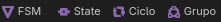
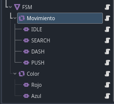
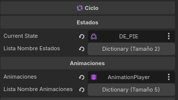
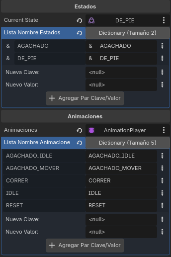
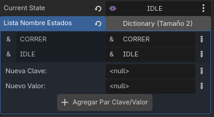
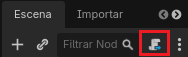
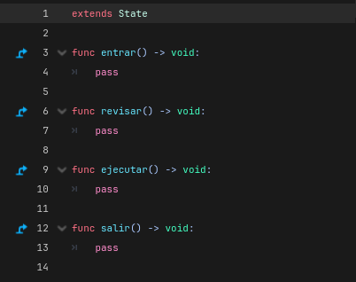
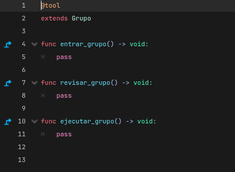
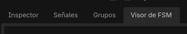
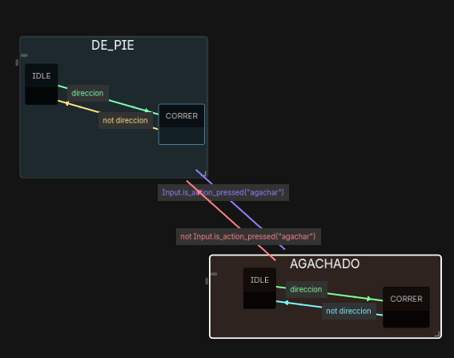

# Finite State Machine

Una Máquina de Estados Finitos (Finite State Machine, FSM) es un patrón de diseño que modela el comportamiento de un sistema mediante un conjunto de estados y las transiciones entre ellos. Cada estado representa una acción o comportamiento específico —como permanecer en reposo, caminar, correr, saltar o atacar—, mientras que las transiciones determinan cuándo y bajo qué condiciones el personaje cambia de un estado a otro.

## Instalación
1. Copiar la carpeta addons en la raíz del proyecto
2. Activar el plugin desde la configuración

**Opcional**: copiar la carpeta `script_templates` en la raíz del proyecto para tener las plantillas para `STATE` y `GRUPO`

## Ejemplo
La carpeta `ejemplo` del repositorio posee un ejemplo de uso.

##
##
## Uso del plugin

## Nodos
Este FSM esta compuesto por nodos 4 tipos de nodos: 


- `STATE`: contiene la lógica del comportamiento del estado y las condiciones para la transición

- `GRUPO`: Es una agrupación de `STATE` de comportamiento común. 

	Por ejemplo, tenemos los `GRUPO` "AGACHADO" y "DE_PIE", ambos con sus `STATE` IDLE y CORRER, en ambos `GRUPO` el personaje esperara o moverá, pero, dependiendo del grupo, la animación y la velocidad cambia. 
	
	Los `GRUPO` permiten saltar de comportamientos de forma sencilla

- `CICLO`: Contiene los `STATE` o `GRUPO` de cada ciclo. Cada uno de estos ciclos se ejecuta de forma independiente. 

	Por ejemplo, tenemos los `GRUPO` "posiciones", que controla la posición del personaje ("AGACHADO" y "DE_PIE") y el `GRUPO` "Mirar", que cambia la animación para que el personaje mire a un lado u otro (simplemente espeja el sprite)


- `FSM`: Nodo raíz del FSM, contiene la lógica del FSM.



## Funciones

### STATE
Los `STATE` poseen 4 funciones que se ejecutan según si esta el `STATE` activado o se cambia de estado:

- **Entrar:** se ejecuta cuando entra el `STATE`, al cambiar de `STATE`

- **Revisar:** se ejecuta cuando el `STATE` esta activo, antes del ejecutar, y se usa para revisar las condiciones que hacen el cambio de `STATE`

- **Ejecutar:** ejecuta el _physics_process del player, contiene la lógica del `STATE`

- **Salir:** se ejecuta cuando sale el `STATE`, al cambiar de `STATE`

Poseen la señal `cambiarEstado` que permite el cambio de `STATE`. Por ejemplo, si estoy en el `STATE` **CORRER** y en revisar tengo `cambiarEstado.emit(LISTA_ESTADOS.IDLE)` ocurrirá lo siguiente:

1. No se ejecutara el **ejecutar** del **CORRER**
2. Se ejecutara el **salir** del **CORRER**
3. Se ejecutara el **entrar** de **IDLE**
4. Quedara activo el `STATE` **IDLE**

Los `STATE` poseen la variable `player` en donde se encuentra el objeto que debe controlar el FSM

### GRUPO
Los `GRUPO` poseen 3 funciones que se ejecutan, al igual que los `STATE`, si esta activado o se cambia de grupo:

- **Entrar_grupo:** se ejecuta cuando entra el `GRUPO`, al cambiar de `GRUPO` o `STATE` 

- **Revisar_grupo:** se ejecuta cuando el `GRUPO` esta activo, antes del ejecutar, y se usa para revisar las condiciones que hacen el cambio de `GRUPO`

- **Ejecutar_grupo:** ejecuta la lógica del `GRUPO`

Las funciones del `GRUPO` se ejecutan a antes del `STATE`, es decir, **Ejecutar_grupo** se ejecuta antes del **ejecutar** del `STATE`, de igual forma para **revisar** y **entrar**

Al igual que `STATE`, los `GRUPO` poseen la señal `cambiarEstado` para cambiar de `GRUPO` o `STATE` y a variable `player` en donde se encuentra el objeto que debe controlar el FSM

## Configuracion de nodos

### `CICLO`

Sera necesario asignar el `Current State`, el `STATE` o `GRUPO` que se ejecuta al iniciar el `CICLO`. También es posible asignar `animaciones`, el `AnimationPlayer` que se usara en el ciclo, este ultimo es opcional.




Las ``LISTA_NOMBRE_ANIMACIONES`` y ``LISTA_ESTADOS`` son diccionarios con, respectivamente, los nombres de las animaciones y `STATE` o `GRUPO`. Son usados para comenzar las animaciones o emitir el cambio de `STATE`. Son solo de referencia y no deben modificarse manualmente, se actualizan al modificar los `STATE` o las animaciones



Ejemplo de uso:

```gdscript 
func entrar() -> void:
	animaciones.play(LISTA_NOMBRE_ANIMACIONES.IDLE)
```

```gdscript 
func revisar() -> void:
	var direccion = Input.get_axis("left", "right")
	if direccion:
		cambiarEstado.emit(LISTA_ESTADOS.CORRER)
```
> [!NOTE]
> El cambio de estado o el inicio de animación se puede realizar usando la lista o escribiendo el nombre de la animación o STATE


### `GRUPO`

De la misma forma sera necesario asignar el `Current State`. También posee un ``LISTA_ESTADOS`` con los nombres de los `STATE` que lo conforman.




 
Los nodos `FSM` y `STATE` no requieren configuración especial.

## Scripts
Para los nodos `STATE` y `GRUPO` es necesario extender los script (no usar el que viene al añadir el nodo)



Lo recomendable es usar las plantillas que vienen en `script_templates`. En ellas ya se encuentran indicadas las funciones que pueden modificarse:

Plantilla `STATE`



Plantilla `GRUPO`




## Visualizador

Adicionalmente, se cuenta con un visor de diagrama de FSM. Aparecerá, cuando se seleccione el nodo `CICLO`, a la derecha, como una nueva pestaña (al lado del editor de las señales o grupos) 



y mostrara el diagrama del ciclo, facilitando la comprensión del FSM



En la primer visualización los estados aparecerán desordenados, para las siguientes visualizaciones, los mismos aparecerán en la ultima posición que se hayan dejado
